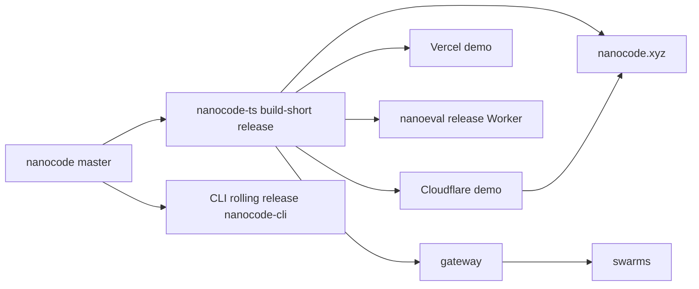

# Release chain

nanocode ships as one core that every user-facing surface runs. A release is one core build moved through every surface in dependency order, checked after each deploy, then measured build against build with nanoeval's systems suite. scripts/release-train.sh runs the chain; this file says what it does, by hand, per surface.



## Surfaces, in dependency order

| # | Surface | Repository | Pin | Deploy | URL |
|---|---------|------------|-----|--------|-----|
| 1 | Core | nanocodexyz/nanocode | master HEAD | none (source of every build) | |
| 2 | nanocode-ts build | nanocodexyz/nanocode-ts | sdk-revision.json = core sha; release build-<short> (tarball, wasm-<fingerprint>) | scripts/pin-rebuild.sh (nanocode-ts scripts/release.mjs) | github.com/nanocodexyz/nanocode-ts/releases |
| 3 | CLI | nanocodexyz/nanocode | rolling release nanocode-cli, assets suffixed with the 12-char core sha, INPUTS + SHA256SUMS | scripts/release-cli.sh build, pack, upload, publish (darwin lanes on a Mac, linux lanes in docker, windows lanes on Windows) | curl -fsSL https://nanocode.xyz/vercel/install \| sh |
| 4 | Docs site and demo front door | nanocodexyz/nanocode-site | wasm-revision.json = nanocode-ts commit (the site builds the wasm from it); binds the Cloudflare demo Worker as a service | pnpm build && wrangler deploy | https://nanocode.xyz |
| 5 | Cloudflare demo | nanocodexyz/durable-cloudflare | package.json nanocode-ts = build-<short> tarball | npm run deploy:demo (Worker nanocode-cloudflare-durable) | https://cloudflare.nanocode.xyz |
| 6 | Vercel demo | nanocodexyz/durable-vercel | package.json nanocode-ts = build-<short> tarball (public/nanocode_wasm.wasm is copied from it at build) | vercel deploy --prod (project nanocode-vercel-durable) | https://nanocode-vercel-durable.vercel.app |
| 7 | nanoeval release Worker | nanocodexyz/nanoeval | package.json nanocode-ts = build-<short> tarball; COMMIT var pin-<nanoeval short>-ncts-<short> | wrangler deploy --name nanoeval-release | https://nanoeval-release.tempo-dev.workers.dev |
| 8 | Gateway | the gateway repository (private) | package.json nanocode-ts = build-<short> tarball | its own DEPLOY.md: staging first, then production with paid calls paused and resumed | owned by the gateway team |
| 9 | swarms | gakonst/swarms | package.json nanocode-ts = build-<short> tarball; reaches agents through the gateway service binding | npm run deploy | owned by the gateway team |

Older pins name github.com/gakonst/nanocode-ts: that repository moved to nanocodexyz/nanocode-ts and the URL redirects, so the same build-<short> tarball serves both. Prefer the nanocodexyz URL when bumping.

## Bumping to a new core build

One command, from a nanocode checkout on a machine with Cloudflare and Vercel logins, gh, node, pnpm and clang 22:

```sh
scripts/release-train.sh plan          # what every surface pins now
scripts/release-train.sh train --cli   # build, CLI, site, Cloudflare demo, Vercel demo, sweep
```

Each step on its own:

1. Core build. scripts/release-train.sh build (or scripts/pin-rebuild.sh [--rev SHA] [--python-too]) pins nanocode-ts sdk-revision.json to the core sha, runs npm ci, scripts/build.mjs, npm run prepare and check:types, pushes the pin to nanocode-ts master and runs nanocode-ts scripts/release.mjs, which publishes build-<short> and wasm-<fingerprint>. Its last line is build-<short> <core sha> <fingerprint> <tarball URL>. --build-only builds without publishing.
2. CLI. Check out the core sha and run scripts/release-cli.sh build <lanes> on each lane's host, then pack and upload per host, then publish once every lane is uploaded. publish refuses a partial set and moves the nanocode-cli tag. The install scripts check SHA256SUMS.
3. Site. scripts/release-train.sh bump site <short> sets wasm-revision.json to the build's nanocode-ts commit; deploy site runs pnpm install, pnpm check:types, pnpm build (scripts/wasm.ts builds the wasm at that commit) and wrangler deploy, then pushes master.
4. Cloudflare demo. bump cf-demo <short> runs npm install <tarball URL> and commits package.json and the lock; deploy cf-demo runs npm run build, npm run dry-run (bundle in output/deploy) and npm run deploy:demo, then pushes master.
5. Vercel demo. bump vercel-demo <short>; deploy vercel-demo runs npm run check and vercel deploy --prod --scope tempoxyz --yes, then pushes master. Note the previous production deployment URL: it stays reachable for build-against-build measurement and rollback.
6. Release Worker. Only when no measurement run is using it (check the runs and ask whoever is measuring). bump release-worker <short>; NANOEVAL_RUNS_IDLE=1 scripts/release-train.sh deploy release-worker bundles with wrangler deploy --dry-run, then wrangler deploy --name nanoeval-release --var COMMIT:pin-<nanoeval short>-ncts-<short>.
7. Gateway, then swarms. Hand the build to their owners: the tarball URL, the core sha, the wasm sha256 and this file. They bump nanocode-ts to the same tarball, deploy staging, run the checks below, then production, then swarms.

The repositories behind surfaces 3 to 6 and 9 have no CI: each AGENTS.md says to build, check and deploy by hand and push to master. Every bump is one commit, chore(deps): nanocode-ts build-<short>.

## Before you deploy

- Take the shared deploy lock on the machine that holds the Cloudflare and Vercel logins: ~/nc-release/deploy.lock (flock ~/nc-release/deploy.lock <command>). Other threads deploy the demos and the site too: a Cloudflare demo version landed from elsewhere between two deploys of the release on 2026-11-17, and the next deploy replaced it.
- git pull --rebase the surface's default branch right before building, and deploy only what is on that branch plus your bump. A deploy from a stale checkout silently reverts the other thread's change.
- Check the live version before and after (wrangler deployments list --name <worker>, vercel ls <project> --prod) and keep the previous id or URL for rollback.

## Checks after each deploy

1. Same core. scripts/release-train.sh verify <surface> <short> compares the deployed wasm's sha256 with dist/nanocode_wasm.wasm in the build-<short> tarball (for build-6d58e23: 2fe83d0b829f9a6f015e42c6e7cfc5246fffad8d24154464ac354faeccfe6cff). The Workers bundle it (output/deploy after the dry run); the Vercel demo installs it from the tarball. A mismatch means the surface runs another core: stop. Each surface also reports its build at a version endpoint (nanocodeTs, nanocodeRev, wasmSha256), which systems-v1's describe() records in every run.
   - The site used to compile its own wasm from the pinned nanocode-ts commit, so its sha256 never equalled the tarball's and only the wasm fingerprint (dist/nanocode-wasm.json) matched. Its scripts/wasm.ts now takes the release tarball's wasm, and builds from source only for development.
2. Stock defaults. A surface runs nanocode's defaults. The only differences allowed are the ones in the table below, each kept for a stated reason. Anything that changes agent behaviour beyond the model choice is removed. Re-read the table against the surface's config every release.
3. Demo safety. On the Vercel demo, needsToken is false, and chaos is on only as the visitor-armed "Kill the next tool call" feature: a plain turn arms nothing, and measurement never calls /api/chaos.
4. Smoke and performance. Run nanoeval's systems suite against every target, this build against the last, then read the client signals:

```sh
scripts/release-train.sh sweep <previous short> <short>            # all targets at once, each compared with the last release
# by hand, one target:
NANOEVAL_SUITES=~/nanoeval-suites node cli/nanoeval.ts systems run --suite systems-v1 --target vercel-demo \
  --build build-<short>=https://nanocode-vercel-durable.vercel.app
node cli/nanoeval.ts systems compare <last release run dir> <this run dir> --base build-<previous short> --head build-<short>
# the CLI, both builds in one run:
node cli/nanoeval.ts systems run --suite systems-v1 --target cli-local --build base=<old 12-char sha> --build head=<new 12-char sha>
```

systems-v1 (versioned in nanoeval-suites, preregistered in prereg/SYSTEMS-V1.md) runs, per target and concurrently: 10+ turn conversations (per-turn TTFT, decode tok/s, turn latency, drift across turns), tens of Code Mode cells (compute, shell, file I/O, parallel tool calls, long cells), Python cells (interpreter start, stdlib and numpy/pandas imports where supported, compute, file I/O, state across cells), cold vs warm start and session resume, and 1/10/50 concurrent sessions (aggregate tok/s, error rate), counting errors, timeouts and stalls, on a matrix of current models (presets in suite.json). Each run writes a timestamped run.json and summary.md: p50/p95 per metric, pass/fail per scenario, SLO pass/fail against the suite's absolute thresholds, and head/base ratios with 95% task-clustered bootstrap intervals read as WIN, TIE or LOSS.

The release verdict is the client signals: TTFT, startup, first byte, cell latency and RSS. Turn time, model calls and tok/s are reported in a separate section, "includes model work", because they also move with how long the model thinks and how many tool calls it makes. A release moves to the next surface only when the surface passes its SLOs and has no client-signal LOSS that can't be explained.

Old-vs-new on a deployed surface: the Vercel demo keeps every deployment at its own URL (behind deployment protection: send the project's automation bypass as NANOEVAL_SYSTEMS_VERCEL_DEMO_BYPASS). The Cloudflare demo and the site have no version preview URLs, so compare the new run with the last release's run dir. The public demos limit each client to 30 requests per minute; sweeps authenticate with NANOEVAL_SYSTEMS_<TARGET>_TOKEN, which the demos' bearer path exempts, and the public limits stay as they are.

The comparison is always nanocode build against nanocode build on our own surfaces. Comparisons with other agents stay in the frontier evals.

## Overrides, features and platform constraints

Everything a surface runs differently from stock nanocode, and why. "Removed" lines are kept so nobody re-adds them.

| Surface | Knob | Value | Stock | Status | Reason |
|---------|------|-------|-------|--------|--------|
| Cloudflare demo | CLAUDE_MODEL | claude-haiku-5-5 | claude-opus-5-5 | kept | product choice: cost of a free public demo |
| Cloudflare demo | OPENAI_SERVICE_TIER | priority | unset | kept | latency choice: the standard tier queued 3.9-7 s before first output vs 0.65-2.0 s on priority; dropping it cost about 1 s first-turn TTFT. Codex sessions only |
| Cloudflare demo | CHAT_PUBLIC, PUBLIC_RATE 30/60 s per client, 2000-char prompts, model allowlist | on | off | kept | feature (public demo) and abuse limit |
| Cloudflare demo | AI_GATEWAY_ID, WORKERS_AI_ACCOUNT_ID, domain | set | | kept | wiring |
| Cloudflare demo | wrangler.jsonc RECOVERY_*, EVENT_*, MODEL_*, PROMPT_CACHE_PRIME_MS, SESSION_POOL_* | repo config | | kept | the Worker's own stock config, not demo overrides |
| Vercel demo | default effort | catalog (medium for haiku) | catalog | removed "low" 2026-11-17 | changed agent behaviour |
| Vercel demo | NANOCODE_MODEL, model allowlist | claude-haiku-5-5; haiku/sonnet 5.5, gpt-6-luna, gpt-6.1-sol, glm-5.3, kimi-k3 | claude-opus-5-5 | kept | product choice: cost of a free public demo |
| Vercel demo | drive windows | 280 s | none | kept | platform limit: function maxDuration 300 s minus margin |
| Vercel demo | HARNESS_CHAOS | 1 | off | kept | feature: visitor-armed "Kill the next tool call" (survives a dead Function); arms nothing by default |
| Vercel demo | charge tool, Tempo wallet MCP, visitor Hands, subagents, durability | on | | kept | features |
| Vercel demo | allowance 0.05 / 10 calls / hour, 20 prompts, 2000 chars | set | | kept | cost limit |
| Site | homepage chat model | gpt-6-luna | catalog | kept | product choice |
| Site | homepage thinking | low | catalog (medium) | kept | cost cap: the free, unauthenticated proxy serves luna at low effort only |
| Site | homepage service tier | priority | standard | kept | latency choice, measured in the site's DECISIONS.md |
| Site | DEMO_LIMIT 30/60 s, image and search limits, 16 MiB requests | set | | kept | abuse and cost limits |
| Site | warm-up request every 10 s | on | | kept | product decision in the site's DECISIONS.md |
| Gateway | per its override audit (find_thread, gateway and Connectors MCP servers, context limits, restricted tools for woken turns) | | | owners | the gateway team keeps its own list; anything that changes agent behaviour should go |

## Rollback

| Surface | Rollback |
|---------|----------|
| nanocode-ts build | Bump surfaces back to the previous build-<short> tarball; releases are never deleted. |
| CLI | Check out the previous core sha and rerun release-cli.sh publish (cached INPUTS make it a re-upload), or point users at a pinned asset name suffixed with that sha. |
| Site | wrangler rollback <version id> --name nanocode-site (ids in wrangler deployments list), then revert the bump commit. |
| Cloudflare demo | wrangler rollback <version id> --name nanocode-cloudflare-durable, then revert the bump commit. |
| Vercel demo | vercel rollback <previous deployment URL> --scope tempoxyz (or vercel promote), then revert the bump commit. |
| Release Worker | wrangler rollback <version id> --name nanoeval-release. |
| Gateway | Its DEPLOY.md rollback (wrangler rollback with paid calls paused). |
| swarms | wrangler rollback <version id> --name swarms. |

release-train.sh deploy saves each Worker's and the Vercel project's recent deployments to $TRAIN_DIR/<surface>.before before deploying, so the previous version id or URL is at hand.
